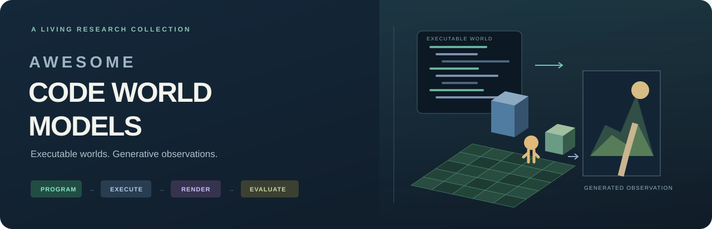

<!-- Generated by tools/build.py. Edit data/papers.json and data/media.json. -->

<b>A research collection on constructing executable visual worlds and turning their execution into generated observations.</b>

[<a href="README.zh-CN.md">中文导览</a>] &nbsp;·&nbsp; [<a href="data/papers.json">JSON</a>] &nbsp;·&nbsp; [<a href="data/papers.csv">CSV</a>] &nbsp;·&nbsp; [<a href="references.bib">BibTeX</a>] &nbsp;·&nbsp; [<a href="docs/READING_NOTES.zh-CN.md">逐篇阅读笔记</a>]

## Watch the worlds

Executable scene → control signal → generated observation. These author-provided demos show different ways to connect the pieces. Click a preview or **▶ Video** to watch the original.

<table>
<tr><td width="33%" valign="top"> <b>Code Video Model</b> Three.js previs → generated video <a href="https://github.com/user-attachments/assets/d1a8594d-14fa-49aa-a101-03da77ed585f">▶ Video</a> · <a href="https://github.com/code-video-model/CodeVideoModel#demo-video">Official source</a></td><td width="33%" valign="top"> <b>Code World Model</b> Persistent code state → visual observations <a href="https://huggingface.co/datasets/NTU-yiwen/code-world-model-project-page-videos/resolve/main/project_page_final/teaser/code_world_model_full_demo.mp4">▶ Video</a> · <a href="https://buaacyw.github.io/cwm/">Official source</a></td><td width="33%" valign="top"> <b>StreamRender-H3</b> Code game engine + streaming renderer <a href="https://huggingface.co/datasets/Efficient-Large-Model/Sana-assets/resolve/main/Sol-Engine/StreamRender-H3/blog-assets/streamrender-h3-demo-71s.mp4">▶ Video</a> · <a href="https://nvlabs.github.io/Sana/Sol-Engine/StreamRender-H3/">Official source</a></td></tr><tr><td width="33%" valign="top"> <b>Matrix-Game 4.0</b> Low-poly gameplay → generated appearance <a href="https://matrix-game-v4-0.github.io/page/assets/prompt/egypt06.mp4">▶ Video</a> · <a href="https://matrix-game-v4-0.github.io/page/">Official source</a></td><td width="33%" valign="top"> <b>AgentGarten</b> Simulator geometry → interactive worlds <a href="https://mirros-lab.github.io/agent-garten/media/hero.mp4">▶ Video</a> · <a href="https://mirros-lab.github.io/agent-garten">Official source</a></td><td width="33%" valign="top"> <b>SolarRenderer</b> Structured video → few-step reference rendering <a href="https://enderfga.cn/SolarRenderer/">▶ Video</a> · <a href="https://github.com/Enderfga/SolarRenderer">Official source</a></td></tr>
</table>

<b>Play the Code Video Model overview on GitHub</b>

Author-uploaded demo from the [official Code Video Model README](https://github.com/code-video-model/CodeVideoModel#demo-video).

https://github.com/user-attachments/assets/d1a8594d-14fa-49aa-a101-03da77ed585f

All demos and preview images belong to their original authors. Links, provenance, and media checks are recorded in [the media manifest](data/media.json). Demo quality alone does not establish generality or interactive latency.

## Explore by research problem

     

**Guide:** [Scope](#scope) · [Systems](#world-systems) · [Construction](#world-construction) · [Dynamics](#programmatic-dynamics) · [Rendering](#generative-rendering) · [Evaluation](#evaluation) · [Surveys](#surveys) · [Verification](docs/VERIFICATION.md) · [Contribute](CONTRIBUTING.md)

## Scope

The organizing object is an **executable visual world**: a scene/world program, engine configuration, articulated character, or explicit set of spatial rules that can be constructed, modified, stepped, or queried for observations.

- **Construct the world:** generate, reconstruct, edit, or identify executable scenes and dynamics.
- **Render its observations:** connect engine execution, scene buffers, physical simulation, or parameterized-character rendering to visual generation.
- **Evaluate the result:** combine executable-world tests with general quality, motion/pose, identity, memory, physics, efficiency, and downstream-use measurements.

Some entries are complete systems; others contribute one component. A 2D proxy, 3D condition, or video input does not independently determine inclusion. General control methods enter the evaluation branch when their measurement protocol is relevant; this does not classify them as complete code world models. Pure GUI reconstruction, educational code videos, and generic video editing without this world interface are outside the method scope. See [examples and boundary decisions](docs/SCOPE.md).

**Dates** below are first arXiv posting dates when available, not conference years. Papers, technical reports, implementations, and official architecture reports are labeled separately. The 154 entries include 8 surveys; they are references, not a claim that all 154 are complete world models. Identity and primary-source checks are documented [here](docs/VERIFICATION.md).

## World Systems

Code, engine state, and generated visual observations in one pipeline.

**16 references** · [Detailed notes](world-systems/README.md)

### 2026

- **SolarRenderer: Few-Step Generative Reference Rendering** · Paper · 2026-10-20
   Uses structure control and few-step LoRAs on MiniMax-H3 for reference rendering, including a block-causal variant.
   [paper](https://arxiv.org/abs/2610.28630) · [code](https://github.com/Enderfga/SolarRenderer) · [project](https://enderfga.cn/SolarRenderer/) · [notes](world-systems/README.md#c10)

- **Mallea: Building, Steering, and Memorizing Worlds with Coding Agent** · Paper · 2026-10-15
   Combines world construction, rule edits, and object texture memory in a coding-agent workflow.
   [paper](https://arxiv.org/abs/2610.21283) · [project](https://lxycopper.github.io/Mallea) · [notes](world-systems/README.md#u058)

- **AgentGarten: Code Worlds for Evolving Agents** · Paper · 2026-10-08
   Connects simulation backends to a shared geometry-conditioned renderer and studies agent practice in the resulting environments.
   [paper](https://arxiv.org/abs/2610.12374) · [code](https://github.com/MirroS-Lab/AgentGarten) · [project](https://mirros-lab.github.io/agent-garten) · [notes](world-systems/README.md#c05)

- **Oneira: From Open-Ended Generation to Open-World Interaction in Video World Models** · Paper · 2026-10-01
   Registers objects and interaction outcomes from generated observations into a persistent, editable world state.
   [paper](https://arxiv.org/abs/2610.01614) · [project](https://madaoer.github.io/projects/oneira) · [notes](world-systems/README.md#u074)

- **GameDirector: Decoupling Gameplay Logic from Rendering for Player-Configurable Game World Models** · Paper · 2026-09-22
   Separates explicit combat states and gameplay rules from video generation through a textual directing interface.
   [paper](https://arxiv.org/abs/2609.25652) · [project](https://jimntu.github.io/gamedirector) · [notes](world-systems/README.md#c04)

- **Code Plans, Diffusion Renders: Open-Ended Generative World Modeling** · Paper · 2026-09-22
   Combines a programmable Three.js world with a video artist and registers generated content back into the world.
   [paper](https://arxiv.org/abs/2609.26458) · [project](https://becauseimbatman0.github.io/CoDeR) · [notes](world-systems/README.md#c03)

- **Programmable World Model** · Paper · 2026-09-09
   Executes entity rules in a persistent engine and turns state-enriched object boxes into aligned video conditions.
   [paper](https://arxiv.org/abs/2609.10540) · [code](https://github.com/AlayaLab/pwm) · [project](https://alaya-lab.github.io/pwm) · [notes](world-systems/README.md#c02)

- **Code World Model: Coding Agent as World Brain** · Paper · 2026-08-26
   Maintains world state with a coding agent and compiles execution into proxy videos for visual generation.
   [paper](https://arxiv.org/abs/2608.25927) · [code](https://github.com/buaacyw/code-world-model) · [project](https://buaacyw.github.io/cwm/) · [notes](world-systems/README.md#c01)

- **StreamRender-H3: Interactive Coding Worlds with Real-time Streaming Diffusion Render** · Technical report · 2026
   Pairs a code game engine with a two-step streaming renderer for interactive visual feedback.
   [project](https://nvlabs.github.io/Sana/Sol-Engine/StreamRender-H3/) · [notes](world-systems/README.md#c07)

- **Streaming Code World Model** · Implementation · 2026
   Adapts Code World Model to causal chunked rendering using diffusion forcing and few-step self-forcing distillation.
   [code](https://github.com/TingtingLiao/streaming-code-world-model) · [notes](world-systems/README.md#z078)

- **Roblox Reality: Hybrid Architecture for Photorealistic Multiplayer Gaming** · Official report · 2026
   Describes a hybrid multiplayer architecture combining authoritative game state with generated visual presentation.
   [source](https://about.roblox.com/newsroom/2026/04/roblox-reality-hybrid-architecture-democratizing-photorealistic-multiplayer-gaming) · [notes](world-systems/README.md#n061)

- **RenderFlow: Single-Step Neural Rendering via Flow Matching** · Paper · 2026
   Maps structured rendering buffers to video observations with a single-step flow-based neural renderer.
   [paper](https://studios.disneyresearch.com/2026/05/31/renderflow-single-step-neural-rendering-via-flow-matching/) · [notes](world-systems/README.md#n059)

- **Matrix-Game 4.0** · Technical report · 2026
   Streams generated visuals from executable low-poly games while keeping gameplay and physics in the native engine.
   [paper](https://github.com/SkyworkAI/Matrix-Game/blob/main/Matrix-Game-4/docs/Matrix_Game_4_0.pdf) · [code](https://github.com/SkyworkAI/Matrix-Game/tree/main/Matrix-Game-4) · [project](https://matrix-game-v4-0.github.io/page/) · [data](https://huggingface.co/Skywork/Matrix-Game-4.0) · [notes](world-systems/README.md#c08)

- **EdenLive: Real-Time Generative Rendering from Any Visual Reference** · Implementation · 2026
   Provides an interactive generative renderer that accepts engine imagery or other visual references.
   [code](https://github.com/VAST-AI-Research/EdenLive) · [notes](world-systems/README.md#c09)

- **DLSS 5: Real-Time Neural Rendering with Generative AI** · Official report · 2026
   Uses game-engine color and motion information for generative neural enhancement in a real-time graphics pipeline.
   [source](https://research.nvidia.com/labs/adlr/DLSS5/) · [notes](world-systems/README.md#n060)

- **Code Video Model** · Technical report · 2026
   Generates executable previs and uses proxy videos, reference appearance, and early-step conditioning to produce final clips.
   [paper](https://code-video-model.github.io/tech_report.pdf) · [code](https://github.com/code-video-model/CodeVideoModel) · [project](https://code-video-model.github.io/) · [notes](world-systems/README.md#c06)

[↑ Back to guide](#explore-by-research-problem)

## World Construction & Recovery

Scene programs, editable environments, articulated assets, and simulation-ready reconstruction.

**43 references** · [Detailed notes](world-construction/README.md)

### 2026

- **Code2Worlds-2: Physically Plausible Agent Harness for Embodied World Simulation** · Paper · 2026-10-13
   Compiles generated scenes into MuJoCo-compatible worlds and refines physical settings with simulator feedback.
   [paper](https://arxiv.org/abs/2610.17651) · [code](https://github.com/AIGeeksGroup/Code2Worlds-2) · [project](https://aigeeksgroup.github.io/Code2Worlds-2) · [notes](world-construction/README.md#t002)

- **VETR: Execution-Grounded Self-Improving Agent for Symbolic Graphics Reasoning** · Paper · 2026-10-09
   Uses execution-grounded verification and program revisions for symbolic graphics reasoning.
   [paper](https://arxiv.org/abs/2610.13098) · [notes](world-construction/README.md#b22)

- **USDCraft: Geometrically Grounded Programmatic Modeling of Articulated 3D Assets for Simulation** · Paper · 2026-10-08
   Produces articulated USD assets with geometry-grounded programs and simulation-relevant physical properties.
   [paper](https://arxiv.org/abs/2610.11322) · [project](https://xingyoujun.github.io/usdcraft) · [notes](world-construction/README.md#b20)

- **EnvDreamer: Large-Scale Multimodal-to-Environment Generation for Embodied AI** · Paper · 2026-10-03
   Converts multimodal specifications into Unreal Engine environments and associated embodied tasks.
   [paper](https://arxiv.org/abs/2610.04301) · [notes](world-construction/README.md#b19)

- **Asking the World: Generalist Physical Reasoning through Agentic World Modeling and Probing** · Paper · 2026-09-30
   Constructs video-grounded multiphysics worlds and actively probes them to answer physical questions.
   [paper](https://arxiv.org/abs/2609.39135) · [notes](world-construction/README.md#p03)

- **Real2Gym: Building Gyms from Videos, Bringing Skills to Robots** · Paper · 2026-09-29
   Recovers interactive training environments from videos and uses them to support robot skill learning.
   [paper](https://arxiv.org/abs/2609.37089) · [project](https://real2gym.github.io) · [notes](world-construction/README.md#b21)

- **EMPIRIC: Experiment-Driven Learning of Residual World Models for Robot Planning** · Paper · 2026-09-28
   Extends a physics engine with learned residual programs and identifies missing mechanisms through experiments.
   [paper](https://arxiv.org/abs/2609.35047) · [project](https://yichao-liang.github.io/empiric) · [notes](world-construction/README.md#p02)

- **Recursive Code World Models: Building Complex Worlds through Recursive Scene Programs** · Paper · 2026-09-10
   Recursively composes scene programs while using rendered comparisons to preserve global structure.
   [paper](https://arxiv.org/abs/2609.11499) · [notes](world-construction/README.md#b18)

- **Code as Worlds: Agentic Discovery of Executable World Representations for Physical Reasoning** · Paper · 2026-08-27
   Proposes, executes, renders, and revises world-program hypotheses for quantitative physical reasoning.
   [paper](https://arxiv.org/abs/2608.27549) · [code](https://github.com/MirroS-Lab/Code-as-World) · [project](https://mirros-lab.github.io/code-as-world) · [notes](world-construction/README.md#p01)

- **PhyScene3D: Physically Consistent Interactive 3D Tabletop Scene Generation** · Paper · 2026-06-01
   Assembles interactive tabletop scenes using geometric placement and physics-based refinement.
   [paper](https://arxiv.org/abs/2606.01649) · [notes](world-construction/README.md#b17)

- **SceneCode: Executable World Programs for Editable Indoor Scenes with Articulated Objects** · Paper · 2026-05-19
   Builds editable indoor-scene programs with articulated objects, execution repair, and explicit scene-state registration.
   [paper](https://arxiv.org/abs/2605.19587) · [project](https://scene-code.github.io) · [notes](world-construction/README.md#b16)

- **Real2Sim in HOI: Toward Physically Plausible HOI Reconstruction from Monocular Videos** · Paper · 2026-05-14
   Recovers human-object motion and projects it into physics-based simulation for more stable interaction rollouts.
   [paper](https://arxiv.org/abs/2605.14462) · [project](https://knoxzhao.github.io/real2sim_in_HOI) · [notes](world-construction/README.md#t034)

- **ChronoAgentic: A Code-based Multi-Agent World Simulator for Physically Grounded Simulation Construction** · Paper · 2026-05-14
   Constructs PyChrono simulations and repairs them using both rendered evidence and deterministic physical checks.
   [paper](https://arxiv.org/abs/2605.14398) · [project](https://uwsbel.github.io/chrono-agentic-website) · [notes](world-construction/README.md#b15)

- **CreativeGame:Toward Mechanic-Aware Creative Game Generation** · Paper · 2026-04-21
   Generates playable games using mechanic planning, prior design traces, and execution-based feedback.
   [paper](https://arxiv.org/abs/2604.19926) · [notes](world-construction/README.md#g03)

- **OpenGame: Open Agentic Coding for Games** · Paper · 2026-04-20
   Organizes game coding, tool use, debugging, and interactive evaluation into an agentic development workflow.
   [paper](https://arxiv.org/abs/2604.18394) · [notes](world-construction/README.md#g02)

- **V-Dreamer: Automating Robotic Simulation and Trajectory Synthesis via Video Generation Priors** · Paper · 2026-03-19
   Builds simulation-ready scenes and converts video motion proposals into executable robot demonstrations.
   [paper](https://arxiv.org/abs/2603.18811) · [notes](world-construction/README.md#t035)

- **Code2Worlds: Empowering Coding LLMs for 4D World Generation** · Paper · 2026-02-12
   Separates object creation from environment orchestration and iteratively revises dynamic scene programs.
   [paper](https://arxiv.org/abs/2602.11757) · [code](https://github.com/AIGeeksGroup/Code2Worlds) · [project](https://aigeeksgroup.github.io/Code2Worlds) · [notes](world-construction/README.md#b14)

### 2025

- **SPARK: Sim-ready Part-level Articulated Reconstruction with VLM Knowledge** · Paper · 2025-12-01
   Combines visual-language knowledge, part generation, and kinematic refinement to recover simulation-ready articulated objects.
   [paper](https://arxiv.org/abs/2512.01629) · [notes](world-construction/README.md#n048)

- **RoboTwin 2.0: A Scalable Data Generator and Benchmark with Strong Domain Randomization for Robust Bimanual Robotic Manipulation** · Paper · 2025-06-22
   Builds diverse bimanual manipulation data with generated task programs and simulation-based correction.
   [paper](https://arxiv.org/abs/2506.18088) · [code](https://github.com/robotwin-Platform/robotwin) · [project](https://robotwin-platform.github.io) · [notes](world-construction/README.md#n030)

- **PhysGen3D: Crafting a Miniature Interactive World from a Single Image** · Paper · 2025-03-26
   Reconstructs an image into an interactive miniature scene whose responses can be simulated under changed initial conditions.
   [paper](https://arxiv.org/abs/2503.20746) · [project](https://by-luckk.github.io/PhysGen3D) · [notes](world-construction/README.md#t024)

- **PhysTwin: Physics-Informed Reconstruction and Simulation of Deformable Objects from Videos** · Paper · 2025-03-23
   Fits deformable-object geometry, appearance, and physical parameters to videos for interactive simulation.
   [paper](https://arxiv.org/abs/2503.17973) · [project](https://jianghanxiao.github.io/phystwin-web) · [notes](world-construction/README.md#n026)

### 2024

- **UnrealZoo: Enriching Photo-realistic Virtual Worlds for Embodied AI** · Paper · 2024-12-30
   Provides Unreal Engine worlds and interaction interfaces for embodied data collection and evaluation.
   [paper](https://arxiv.org/abs/2412.20977) · [notes](world-construction/README.md#t027)

- **Scene Co-pilot: Procedural Text to Video Generation with Human in the Loop** · Paper · 2024-11-26
   Supports human-guided scene generation and editing through procedural commands and Blender execution.
   [paper](https://arxiv.org/abs/2411.18644) · [project](https://abolfazl-sh.github.io/Scene_co-pilot_site) · [notes](world-construction/README.md#t026)

- **PhysMotion: Physics-Grounded Dynamics From a Single Image** · Paper · 2024-11-26
   Simulates reconstructed objects and refines their rendered dynamics with a video diffusion model.
   [paper](https://arxiv.org/abs/2411.17189) · [project](https://supertan0204.github.io/physmotion_website) · [notes](world-construction/README.md#s103)

- **Phys4DGen: Physics-Compliant 4D Generation with Multi-Material Composition Perception** · Paper · 2024-11-25
   Infers material composition and uses multiphysics simulation to generate dynamic 4D objects.
   [paper](https://arxiv.org/abs/2411.16800) · [project](https://jiajinglin.github.io/Phys4DGen) · [notes](world-construction/README.md#s102)

- **The Scene Language: Representing Scenes with Programs, Words, and Embeddings** · Paper · 2024-10-22
   Combines programs, language, and visual embeddings to represent scene structure, semantics, and appearance.
   [paper](https://arxiv.org/abs/2410.16770) · [notes](world-construction/README.md#b13)

- **Articulate-Anything: Automatic Modeling of Articulated Objects via a Vision-Language Foundation Model** · Paper · 2024-10-03
   Generates and revises articulation code to turn multimodal object descriptions into simulator-compatible digital twins.
   [paper](https://arxiv.org/abs/2410.13882) · [project](https://articulate-anything.github.io) · [notes](world-construction/README.md#n025)

- **DreamGarden: A Designer Assistant for Growing Games from a Single Prompt** · Paper · 2024-10-02
   Decomposes a game concept into inspectable development plans and specialized implementation steps.
   [paper](https://arxiv.org/abs/2410.01791) · [notes](world-construction/README.md#g01)

- **SceneMotifCoder: Example-driven Visual Program Learning for Generating 3D Object Arrangements** · Paper · 2024-08-05
   Learns compact arrangement programs from examples and reuses them to generate new object configurations.
   [paper](https://arxiv.org/abs/2408.02211) · [project](https://3dlg-hcvc.github.io/smc) · [notes](world-construction/README.md#b12)

- **Infinigen Indoors: Photorealistic Indoor Scenes using Procedural Generation** · Paper · 2024-06-17
   Extends procedural world generation to indoor assets and constraint-based scene arrangement.
   [paper](https://arxiv.org/abs/2406.11824) · [notes](world-construction/README.md#b11)

- **Real2Code: Reconstruct Articulated Objects via Code Generation** · Paper · 2024-06-12
   Recovers articulated structure from visual evidence and generates executable joint and link descriptions.
   [paper](https://arxiv.org/abs/2406.08474) · [notes](world-construction/README.md#n028)

- **BlenderAlchemy: Editing 3D Graphics with Vision-Language Models** · Paper · 2024-04-26
   Searches over Blender edits using visual-language feedback to revise scene geometry, materials, and lighting.
   [paper](https://arxiv.org/abs/2404.17672) · [notes](world-construction/README.md#b10)

- **PhysDreamer: Physics-Based Interaction with 3D Objects via Video Generation** · Paper · 2024-04-19
   Uses video-generation priors to infer physical properties for explicit simulation of object interactions.
   [paper](https://arxiv.org/abs/2404.13026) · [project](https://physdreamer.github.io) · [notes](world-construction/README.md#t032)

- **Video2Game: Real-time, Interactive, Realistic and Browser-Compatible Environment from a Single Video** · Paper · 2024-04-15
   Converts a scene video into an interactive environment that can run in a browser.
   [paper](https://arxiv.org/abs/2404.09833) · [project](https://video2game.github.io) · [notes](world-construction/README.md#b24)

- **PhyScene: Physically Interactable 3D Scene Synthesis for Embodied AI** · Paper · 2024-04-15
   Generates layouts with collision, room-boundary, and interaction constraints for embodied simulation.
   [paper](https://arxiv.org/abs/2404.09465) · [project](https://physcene.github.io) · [notes](world-construction/README.md#b09)

- **SceneScript: Reconstructing Scenes With An Autoregressive Structured Language Model** · Paper · 2024-03-19
   Reconstructs editable scenes as autoregressively generated structured language commands.
   [paper](https://arxiv.org/abs/2403.13064) · [notes](world-construction/README.md#b08)

- **SceneCraft: An LLM Agent for Synthesizing 3D Scene as Blender Code** · Paper · 2024-03-02
   Produces Blender scene programs, refines them using rendered feedback, and learns reusable scene-building functions.
   [paper](https://arxiv.org/abs/2403.01248) · [notes](world-construction/README.md#b07)

### 2023

- **Holodeck: Language Guided Generation of 3D Embodied AI Environments** · Paper · 2023-12-14
   Translates language into embodied environments through floor planning, asset retrieval, and spatial constraint solving.
   [paper](https://arxiv.org/abs/2312.09067) · [notes](world-construction/README.md#b05)

- **RoboGen: Towards Unleashing Infinite Data for Automated Robot Learning via Generative Simulation** · Paper · 2023-11-02
   Generates simulation tasks, scene layouts, and learning supervision for robot skill acquisition.
   [paper](https://arxiv.org/abs/2311.01455) · [notes](world-construction/README.md#b04)

- **GenSim: Generating Robotic Simulation Tasks via Large Language Models** · Paper · 2023-10-02
   Generates robotic simulation-task code and demonstrations through language-model-guided task synthesis.
   [paper](https://arxiv.org/abs/2310.01361) · [code](https://github.com/liruiw/GenSim) · [project](https://liruiw.github.io/gensim) · [data](https://huggingface.co/spaces/Gen-Sim/Gen-Sim) · [notes](world-construction/README.md#b23)

- **Infinite Photorealistic Worlds using Procedural Generation** · Paper · 2023-06-15
   Builds natural environments from procedural geometry, materials, and scene-generation rules.
   [paper](https://arxiv.org/abs/2306.09310) · [notes](world-construction/README.md#b03)

### 2022

- **ProcTHOR: Large-Scale Embodied AI Using Procedural Generation** · Paper · 2022-06-14
   Procedurally assembles interactive houses for scalable embodied-agent training and evaluation.
   [paper](https://arxiv.org/abs/2206.06994) · [notes](world-construction/README.md#b02)

### 2018

- **Scenic: A Language for Scenario Specification and Scene Generation** · Paper · 2018-09-25
   Defines scene distributions with a probabilistic language and samples configurations subject to spatial constraints.
   [paper](https://arxiv.org/abs/1809.09310) · [notes](world-construction/README.md#b01)

[↑ Back to guide](#explore-by-research-problem)

## Programmatic Dynamics & Rules

Executable transition models, rule induction, active identification, and planning.

**21 references** · [Detailed notes](programmatic-dynamics/README.md)

### 2026

- **RoleWorld: Knowledge Transfer in World Modeling with Functional Role Abstractions** · Paper · 2026-10-09
   Transfers executable world knowledge across environments through functional-role abstractions.
   [paper](https://arxiv.org/abs/2610.13172) · [notes](programmatic-dynamics/README.md#a16)

- **Memento 3: Model-Based Recursive Self-Improvement through Reflective Rulebooks** · Paper · 2026-10-08
   Revises reflective rulebooks and compiles them into executable models for prediction and planning.
   [paper](https://arxiv.org/abs/2610.11794) · [notes](programmatic-dynamics/README.md#a14)

- **Kepler: Auditable World Models for ARC-AGI-3** · Paper · 2026-09-30
   Audits executable game hypotheses using replay and action-time prediction checks.
   [paper](https://arxiv.org/abs/2610.00834) · [project](https://kepler-harness.vercel.app) · [notes](programmatic-dynamics/README.md#a13)

- **Twin: Playing an Unknown Game with a Test-Time Digital Twin** · Paper · 2026-08-14
   Creates a test-time game twin and checks replayed transitions before using it to select actions.
   [paper](https://arxiv.org/abs/2608.14490) · [code](https://github.com/Alexyskoutnev/TWIN-ARC-AGI-3) · [project](https://arc-agi-3-twin.vercel.app) · [notes](programmatic-dynamics/README.md#a12)

- **Tycho: Active Abstraction with Programmatic World Models for ARC-AGI-3** · Paper · 2026-07-30
   Actively builds and tests programmatic abstractions for unfamiliar interactive visual puzzles.
   [paper](https://arxiv.org/abs/2607.28287) · [code](https://github.com/NIMI-research/Tycho) · [notes](programmatic-dynamics/README.md#a11)

- **World-Time Compute with Verified Code World Models** · Paper · 2026-07-07
   Uses verified world programs to generate precise training trajectories for downstream models.
   [paper](https://arxiv.org/abs/2609.09163) · [code](https://github.com/quome-cloud/openworld) · [notes](programmatic-dynamics/README.md#u048)

- **OPINE-World: Programmatic World Modeling with Ontology-error-Prioritized Interactive Exploration for ARC-AGI-3** · Paper · 2026-07-01
   Prioritizes ontology errors when exploring and repairing programmatic models of interactive visual environments.
   [paper](https://arxiv.org/abs/2607.01531) · [notes](programmatic-dynamics/README.md#a15)

- **Mind-Studio: Executable World Models with Lookahead Evaluation for Partially Observable Games** · Paper · 2026-06-14
   Evaluates synthesized game models with multi-step lookahead under partial observability.
   [paper](https://arxiv.org/abs/2606.16070) · [notes](programmatic-dynamics/README.md#a10)

- **Distilling Game Code World Model Generation into Lightweight Large Language Models** · Paper · 2026-05-23
   Distills game-world program generation into smaller coding models using supervised and verifiable-reward training.
   [paper](https://arxiv.org/abs/2605.24375) · [notes](programmatic-dynamics/README.md#a08)

- **Executable World Models for ARC-AGI-3 in the Era of Coding Agents** · Paper · 2026-05-06
   Studies verification-driven executable world models for ARC-AGI-3 environments.
   [paper](https://arxiv.org/abs/2605.05138) · [code](https://github.com/astroseger/arc-3-agents-baseline1) · [notes](programmatic-dynamics/README.md#u050)

- **Learning Abstractions for Hierarchical Planning in Program-Synthesis Agents** · Paper · 2026-01-31
   Learns reusable program abstractions for hierarchical planning from interaction experience.
   [paper](https://arxiv.org/abs/2602.00929) · [notes](programmatic-dynamics/README.md#a17)

### 2025

- **One Life to Learn: Inferring Symbolic World Models for Stochastic Environments from Unguided Exploration** · Paper · 2025-10-14
   Infers stochastic symbolic dynamics through unguided exploration in an object-oriented game environment.
   [paper](https://arxiv.org/abs/2510.12088) · [project](https://onelife-worldmodel.github.io) · [notes](programmatic-dynamics/README.md#a07)

- **Code World Models for General Game Playing** · Paper · 2025-10-06
   Compiles game descriptions and trajectories into executable rules for transition, legality, and search.
   [paper](https://arxiv.org/abs/2510.04542) · [notes](programmatic-dynamics/README.md#a06)

- **Finite Automata Extraction: Low-data World Model Learning as Programs from Gameplay Video** · Paper · 2025-08-15
   Extracts compact program-like game dynamics from a small amount of gameplay video.
   [paper](https://arxiv.org/abs/2508.11836) · [notes](programmatic-dynamics/README.md#a05)

- **PoE-World: Compositional World Modeling with Products of Programmatic Experts** · Paper · 2025-05-16
   Combines programmatic experts to model stochastic game dynamics for planning.
   [paper](https://arxiv.org/abs/2505.10819) · [project](https://topwasu.github.io/poe-world) · [notes](programmatic-dynamics/README.md#a04)

- **Synthesizing world models for bilevel planning** · Paper · 2025-03-26
   Learns executable world abstractions and uses them in hierarchical planning.
   [paper](https://arxiv.org/abs/2503.20124) · [notes](programmatic-dynamics/README.md#a03)

### 2024

- **FactorSim: Generative Simulation via Factorized Representation** · Paper · 2024-09-26
   Factorizes simulation generation into state, action-dependent dynamics, independent dynamics, and observation components.
   [paper](https://arxiv.org/abs/2409.17652) · [notes](programmatic-dynamics/README.md#n001)

- **Generating Code World Models with Large Language Models Guided by Monte Carlo Tree Search** · Paper · 2024-05-24
   Searches over world-model programs with generation, improvement, and execution-based repair operations.
   [paper](https://arxiv.org/abs/2405.15383) · [notes](programmatic-dynamics/README.md#a02)

- **WorldCoder, a Model-Based LLM Agent: Building World Models by Writing Code and Interacting with the Environment** · Paper · 2024-02-19
   Synthesizes executable transition models from interaction and uses planning constraints to guide model revisions.
   [paper](https://arxiv.org/abs/2402.12275) · [notes](programmatic-dynamics/README.md#a01)

### 2018

- **Automated Game Design via Conceptual Expansion** · Paper · 2018-09-06
   Recombines learned game representations to synthesize new game mechanics and content.
   [paper](https://arxiv.org/abs/1809.02232) · [notes](programmatic-dynamics/README.md#h02)

### 2017

- **Game Engine Learning from Video** · Paper · 2017
   Learns an executable approximation of a game engine from gameplay video.
   [paper](https://www.ijcai.org/Proceedings/2017/518) · [notes](programmatic-dynamics/README.md#h01)

[↑ Back to guide](#explore-by-research-problem)

## Generative Rendering

Engine-to-video, rendering buffers, scene choreography, character rendering, and simulation-to-real observations.

**40 references** · [Detailed notes](generative-rendering/README.md)

### 2026

- **RoboRender: Robot-Oriented Video Generation for Visual Sim-to-Real Transfer** · Paper · 2026-10-07
   Converts simulated robot observations into more realistic training videos using geometry and robot-preserving conditions.
   [paper](https://arxiv.org/abs/2610.09254) · [project](https://robo-render.github.io) · [notes](generative-rendering/README.md#n006)

- **CoaG: Cylinders on a Grid for Coarse 3D Layout Control in Video Generation** · Paper · 2026-09-21
   Renders coarse 3D layouts with stable object identities to guide camera and entity placement.
   [paper](https://arxiv.org/abs/2609.24208) · [project](https://zshyang.github.io/CoaG) · [notes](generative-rendering/README.md#t018)

- **LynnReal-Omni: Native multi-modal Video Generation for Agentic Visual Workflows** · Paper · 2026-09-14
   Unifies rendering, reference control, and editing with heterogeneous visual conditions in shared video models.
   [paper](https://arxiv.org/abs/2609.15863) · [notes](generative-rendering/README.md#n052)

- **RGBX-Next: Towards Realistic Generative Rendering from G-Buffers** · Paper · 2026-08-14
   Unifies RGB and typed rendering-buffer inputs in a multimodal video renderer.
   [paper](https://arxiv.org/abs/2608.13929) · [notes](generative-rendering/README.md#n002)

- **UniMoCa: Unifying Motion and Camera Controls as Visual Proxies for Faithful Human Video Generation** · Paper · 2026-08-03
   Combines articulated motion, multi-person layouts, and camera trajectories into visual proxies.
   [paper](https://arxiv.org/abs/2608.01944) · [project](https://tanliming-daniel.github.io/UniMoCa) · [notes](generative-rendering/README.md#t012)

- **VideoCoCo: Code-as-CoT for Physically-Consistent Video Generation via an Agentic Dual-Engine System** · Paper · 2026-07-29
   Generates executable Blender drafts and uses a second visual engine to produce physically guided videos.
   [paper](https://arxiv.org/abs/2607.27380) · [notes](generative-rendering/README.md#t004)

- **Generative World Renderer at the Speed of Play** · Paper · 2026-07-21
   Accelerates buffer-conditioned world rendering with few-step autoregression and a lightweight video codec.
   [paper](https://arxiv.org/abs/2607.18703) · [notes](generative-rendering/README.md#r05)

- **ProxyUp: Training-Free Proxy-Conditioned Video Generation for Controllable Dynamics** · Paper · 2026-07-04
   Uses motion extracted from proxy videos to control a pretrained video generator without additional training.
   [paper](https://arxiv.org/abs/2607.03732) · [project](https://zanue.github.io/proxyup) · [notes](generative-rendering/README.md#n039)

- **3D Scene-Adaptive Trajectory-Controllable Human Image Animation with Camera Movement** · Paper · 2026-06-29
   Adapts articulated motion to scene geometry and combines visibility-aware conditions for camera-controlled character animation.
   [paper](https://arxiv.org/abs/2606.30514) · [project](https://robinhood256100.github.io/web-disp) · [notes](generative-rendering/README.md#t033)

- **Directing the World: Fast Autoregressive Video Generation with Compositional Human-Camera Control** · Paper · 2026-06-26
   Composes human-motion and camera controls in fast autoregressive video generation.
   [paper](https://arxiv.org/abs/2606.27964) · [project](https://whydahuzi.github.io/Directing-the-World.github.io) · [notes](generative-rendering/README.md#t013)

- **ActCam: Zero-Shot Joint Camera and 3D Motion Control for Video Generation** · Paper · 2026-05-07
   Reprojects character and scene conditions under a target camera and schedules their use during video sampling.
   [paper](https://arxiv.org/abs/2605.06667) · [project](https://elkhomar.github.io/actcam) · [notes](generative-rendering/README.md#t011)

- **ComSim: Building Scalable Real-World Robot Data Generation via Compositional Simulation** · Paper · 2026-04-13
   Replays real actions in simulation and composes dynamics conditions to synthesize robot training videos.
   [paper](https://arxiv.org/abs/2604.11386) · [project](https://faceong.github.io/ComSim) · [notes](generative-rendering/README.md#n007)

- **Lighting-grounded Video Generation with Renderer-based Agent Reasoning** · Paper · 2026-04-09
   Uses an agent-controlled renderer to supply lighting-grounded conditions for video generation.
   [paper](https://arxiv.org/abs/2604.07966) · [notes](generative-rendering/README.md#t005)

- **HumANDiff: Articulated Noise Diffusion for Motion-Consistent Human Video Generation** · Paper · 2026-04-07
   Renders surface-attached noise through an articulated body to improve motion-consistent video synthesis.
   [paper](https://arxiv.org/abs/2604.05961) · [project](https://taohuumd.github.io/projects/HumANDiff) · [notes](generative-rendering/README.md#t014)

- **Generative World Renderer** · Paper · 2026-04-02
   Trains generative rendering from synchronized game imagery and structured rendering buffers.
   [paper](https://arxiv.org/abs/2604.02329) · [project](https://alaya-studio.github.io/renderer) · [notes](generative-rendering/README.md#r04)

- **VideoWeaver: Multimodal Multi-View Video-to-Video Transfer for Embodied Agents** · Paper · 2026-03-26
   Transfers synchronized multimodal scene views into videos for embodied-agent workflows.
   [paper](https://arxiv.org/abs/2603.25420) · [notes](generative-rendering/README.md#u057)

- **Hand2World: Autoregressive Egocentric Interaction Generation via Free-Space Hand Gestures** · Paper · 2026-02-10
   Uses projected hand geometry and camera rays to control generated egocentric interactions.
   [paper](https://arxiv.org/abs/2602.09600) · [notes](generative-rendering/README.md#t016)

- **Coarse-to-Real: Generative Rendering for Populated Dynamic Scenes** · Paper · 2026-01-29
   Transfers coarse 3D crowd simulations into realistic videos through staged synthetic-real adaptation.
   [paper](https://arxiv.org/abs/2601.22301) · [project](https://gonzalognogales.github.io/coarse2real) · [notes](generative-rendering/README.md#r03)

### 2025

- **FrameDiffuser: G-Buffer-Conditioned Diffusion for Neural Forward Frame Rendering** · Paper · 2025-12-18
   Conditions frame generation on rendering buffers and previous outputs for temporally coherent neural rendering.
   [paper](https://arxiv.org/abs/2512.16670) · [notes](generative-rendering/README.md#r02)

- **LAMP: Language-Assisted Motion Planning for Controllable Video Generation** · Paper · 2025-12-03
   Compiles a motion-planning language into object-camera trajectories and visual control signals.
   [paper](https://arxiv.org/abs/2512.03619) · [project](https://cyberiada.github.io/LAMP) · [notes](generative-rendering/README.md#t006)

- **PhysChoreo: Physics-Controllable Video Generation with Part-Aware Semantic Grounding** · Paper · 2025-11-25
   Grounds part-level physical controls in rigid-body and material-point simulation before visual generation.
   [paper](https://arxiv.org/abs/2511.20562) · [notes](generative-rendering/README.md#t007)

- **X2Video: Adapting Diffusion Models for Multimodal Controllable Neural Video Rendering** · Paper · 2025-10-09
   Adapts diffusion models to intrinsic rendering channels, reference imagery, and local or global text control.
   [paper](https://arxiv.org/abs/2510.08530) · [project](https://luckyhzt.github.io/x2video) · [notes](generative-rendering/README.md#r09)

- **IllumiCraft: Unified Geometry and Illumination Diffusion for Controllable Video Generation** · Paper · 2025-06-03
   Combines rendered lighting, appearance references, and geometric motion conditions for controllable video synthesis.
   [paper](https://arxiv.org/abs/2506.03150) · [notes](generative-rendering/README.md#s101)

- **Uni3C: Unifying Precisely 3D-Enhanced Camera and Human Motion Controls for Video Generation** · Paper · 2025-04-21
   Combines scene point clouds and articulated characters in a shared 3D guidance interface for camera and motion control.
   [paper](https://arxiv.org/abs/2504.14899) · [code](https://github.com/ewrfcas/Uni3C) · [notes](generative-rendering/README.md#u071)

- **Cosmos-Transfer1: Conditional World Generation with Adaptive Multimodal Control** · Paper · 2025-03-18
   Transfers structured simulation or visual conditions into generated observations using multimodal control.
   [paper](https://arxiv.org/abs/2503.14492) · [code](https://github.com/nvidia-cosmos/cosmos-transfer1) · [notes](generative-rendering/README.md#u037)

- **ReBot: Scaling Robot Learning with Real-to-Sim-to-Real Robotic Video Synthesis** · Paper · 2025-03-15
   Replays robotic trajectories in simulation and composites robot-object renderings into real backgrounds.
   [paper](https://arxiv.org/abs/2503.14526) · [project](https://yuffish.github.io/rebot) · [notes](generative-rendering/README.md#n038)

- **Re$^3$Sim: Generating High-Fidelity Simulation Data via 3D-Photorealistic Real-to-Sim for Robotic Manipulation** · Paper · 2025-02-12
   Reconstructs real scenes and connects them to physical simulation and photorealistic demonstration rendering.
   [paper](https://arxiv.org/abs/2502.08645) · [project](https://re3sim.github.io) · [notes](generative-rendering/README.md#n008)

- **CineMaster: A 3D-Aware and Controllable Framework for Cinematic Text-to-Video Generation** · Paper · 2025-02-12
   Compiles 3D object and camera choreography into depth, class, and camera conditions for cinematic video generation.
   [paper](https://arxiv.org/abs/2502.08639) · [project](https://cinemaster-dev.github.io) · [notes](generative-rendering/README.md#t001)

- **MotionCanvas: Cinematic Shot Design with Controllable Image-to-Video Generation** · Paper · 2025-02-06
   Translates scene-centered shot design into object and camera motion conditions for video generation.
   [paper](https://arxiv.org/abs/2502.04299) · [project](https://motion-canvas25.github.io) · [notes](generative-rendering/README.md#t021)

- **DiffusionRenderer: Neural Inverse and Forward Rendering with Video Diffusion Models** · Paper · 2025-01-30
   Learns inverse and forward rendering between RGB videos, scene buffers, and lighting conditions.
   [paper](https://arxiv.org/abs/2501.18590) · [project](https://research.nvidia.com/labs/toronto-ai/DiffusionRenderer/) · [notes](generative-rendering/README.md#r01)

- **Diffusion as Shader: 3D-aware Video Diffusion for Versatile Video Generation Control** · Paper · 2025-01-07
   Uses rendered 3D tracking guidance to control camera motion, mesh animation, and object motion in video generation.
   [paper](https://arxiv.org/abs/2501.03847) · [code](https://github.com/IGL-HKUST/DiffusionAsShader) · [project](https://igl-hkust.github.io/das) · [notes](generative-rendering/README.md#r06)

### 2024

- **AutoVFX: Physically Realistic Video Editing from Natural Language Instructions** · Paper · 2024-11-04
   Executes language-directed scene and physics edits, then renders and composites their visual consequences into video.
   [paper](https://arxiv.org/abs/2411.02394) · [project](https://haoyuhsu.github.io/autovfx-website) · [notes](generative-rendering/README.md#t036)

- **Tex4D: Zero-shot 4D Scene Texturing with Video Diffusion Models** · Paper · 2024-10-14
   Uses shared UV-space information across views and time to texture dynamic scenes with video diffusion.
   [paper](https://arxiv.org/abs/2410.10821) · [project](https://tex4d.github.io) · [notes](generative-rendering/README.md#s104)

- **PhysGen: Rigid-Body Physics-Grounded Image-to-Video Generation** · Paper · 2024-09-27
   Runs estimated rigid-body dynamics and refines the resulting renderings into videos.
   [paper](https://arxiv.org/abs/2409.18964) · [project](https://stevenlsw.github.io/physgen) · [notes](generative-rendering/README.md#u073)

- **SimGen: Simulator-conditioned Driving Scene Generation** · Paper · 2024-06-13
   Uses simulator observations as explicit controls for realistic driving-scene generation.
   [paper](https://arxiv.org/abs/2406.09386) · [notes](generative-rendering/README.md#n029)

- **Champ: Controllable and Consistent Human Image Animation with 3D Parametric Guidance** · Paper · 2024-03-21
   Renders an articulated human model into depth, normal, semantic, and pose guidance for character animation.
   [paper](https://arxiv.org/abs/2403.14781) · [project](https://fudan-generative-vision.github.io/champ) · [notes](generative-rendering/README.md#t028)

### 2023

- **Generative Rendering: Controllable 4D-Guided Video Generation with 2D Diffusion Models** · Paper · 2023-12-03
   Uses explicit 4D scene correspondences to guide temporally coherent generation with image diffusion models.
   [paper](https://arxiv.org/abs/2312.01409) · [project](https://primecai.github.io/generative_rendering/) · [notes](generative-rendering/README.md#r07)

- **GPT4Motion: Scripting Physical Motions in Text-to-Video Generation via Blender-Oriented GPT Planning** · Paper · 2023-11-21
   Generates Blender physics scripts and uses their execution to guide visual synthesis.
   [paper](https://arxiv.org/abs/2311.12631) · [notes](generative-rendering/README.md#u072)

### 2021

- **Enhancing Photorealism Enhancement** · Paper · 2021-05-10
   Enhances rendered game imagery using rendering-buffer information and learned appearance refinement.
   [paper](https://arxiv.org/abs/2105.04619) · [code](https://github.com/intel-isl/PhotorealismEnhancement) · [notes](generative-rendering/README.md#n043)

### 2019

- **Deferred Neural Rendering: Image Synthesis using Neural Textures** · Paper · 2019-04-28
   Learns surface-attached neural textures and decodes them into scene observations with a neural renderer.
   [paper](https://arxiv.org/abs/1904.12356) · [notes](generative-rendering/README.md#n042)

[↑ Back to guide](#explore-by-research-problem)

## Data & Evaluation

Code-world benchmarks alongside general video quality, control, memory, and physical evaluation.

**26 references** · [Detailed notes](evaluation/README.md)

### 2026

- **PhysCodeGym: Benchmarking Coding Agents for Physically Verifiable 4D Reconstruction** · Paper · 2026-10-12
   Evaluates video-to-program reconstruction with explicit physical variables and executable checks.
   [paper](https://arxiv.org/abs/2610.17288) · [code](https://github.com/ShaoShuai0605/PhysCodeGym) · [notes](evaluation/README.md#t037)

- **ExeWorldBench: Benchmarking Code-Based Executable 3D World Modeling** · Paper · 2026-10-10
   Evaluates code-based 3D world construction across mechanism, composition, and intent constraints.
   [paper](https://arxiv.org/abs/2610.15166) · [notes](evaluation/README.md#u049)

- **WorldSolver: Can LLM Agents Simulate the Physical Dynamics via Solver Generation?** · Paper · 2026-10-06
   Tests agents on building executable physical solvers rather than only describing physical behavior.
   [paper](https://arxiv.org/abs/2610.08720) · [code](https://github.com/sirujiang/WorldSolver) · [notes](evaluation/README.md#e08)

- **Video2World: Benchmarking Coding Agents for Interactive World Modeling from Embodied Videos** · Paper · 2026-10-03
   Evaluates reconstruction of embodied videos into worlds with geometric, dynamic, and functional tests.
   [paper](https://arxiv.org/abs/2610.04432) · [project](https://aetherlabsai.github.io/Video2World) · [notes](evaluation/README.md#e07)

- **4DCodeBench: Benchmarking Agents on Inverse Graphics of Dynamic Scenes** · Paper · 2026-10-02
   Tests dynamic video reconstruction as executable graphics programs across scene and motion properties.
   [paper](https://arxiv.org/abs/2610.03715) · [code](https://github.com/4DCodeBench/4DCodeBench) · [project](https://4dcodebench.com) · [notes](evaluation/README.md#t003)

- **World Editing: Intervening on Executable Worlds at Increasing Depth** · Paper · 2026-10-01
   Benchmarks edits at different depths of an executable game world, from attributes to dynamics and systems.
   [paper](https://arxiv.org/abs/2610.02331) · [project](https://vinesmsuic.github.io/IGMWorld) · [notes](evaluation/README.md#e06)

- **PROWBench: Do Video Models Render What the Program Specifies?** · Paper · 2026-10-01
   Checks generated observations against replayable world records, entity states, and timestamped events.
   [paper](https://arxiv.org/abs/2610.02205) · [code](https://github.com/AlayaLab/PROWBench) · [project](https://alaya-lab.github.io/PROWBench) · [notes](evaluation/README.md#e05)

- **World Agent: Can Language Models Keep a World Running?** · Paper · 2026-09-26
   Studies agent-generated worlds and the evidence needed to validate their behavior.
   [paper](https://arxiv.org/abs/2609.32692) · [code](https://github.com/HCPLab-SYSU/WorldAgent-Benchmark) · [notes](evaluation/README.md#u068)

- **BVB: Benchmarking Agentic Video Understanding via Programmatic Reconstruction in Blender** · Paper · 2026-09-14
   Measures video understanding by reconstructing observed scenes and events as Blender programs.
   [paper](https://arxiv.org/abs/2609.15478) · [notes](evaluation/README.md#e04)

- **R2M-Bench: Evaluating Revisit Memory via Relative Consistency in Interactive Video World Models** · Paper · 2026-08-27
   Evaluates revisit memory with time-gap-matched controls to separate recall from short-term similarity.
   [paper](https://arxiv.org/abs/2608.27328) · [code](https://github.com/AMAP-ML/R2MBench) · [notes](evaluation/README.md#n034)

- **PlayWorld: Benchmarking World Models with Agent Players over Long-Horizon Objectives** · Paper · 2026-08-13
   Uses agent players and sustained tasks to evaluate interactive generated environments.
   [paper](https://arxiv.org/abs/2608.13552) · [code](https://github.com/kxding/PlayWorld) · [project](https://kxding.github.io/project/PlayWorld) · [notes](evaluation/README.md#u069)

- **When a Verified World Model Still Loses: Play-Adequacy vs Prediction-Accuracy in LLM-Synthesized Code World Models** · Paper · 2026-07-15
   Analyzes why accurate replay of sampled transitions can still leave a programmatic model unsuitable for play.
   [paper](https://arxiv.org/abs/2607.14169) · [code](https://github.com/JaviMaligno/code-world-models) · [notes](evaluation/README.md#n031)

- **GameCraft-Bench: Can Agents Build Playable Games End-to-End in a Real Game Engine?** · Paper · 2026-06-16
   Evaluates whether agents build complete, playable game-engine projects that satisfy specified requirements.
   [paper](https://arxiv.org/abs/2606.17861) · [project](https://tongxuluo.github.io/gamecraft-bench-website) · [notes](evaluation/README.md#e03)

- **WorldCoder-Bench: Benchmarking Physically Grounded 3D World Synthesis** · Paper · 2026-06-01
   Tests 3D world generation with hidden-state probes and executable behavior checks.
   [paper](https://arxiv.org/abs/2606.01869) · [notes](evaluation/README.md#e02)

- **MBench: A Comprehensive Benchmark on Memory Capability for Video World Models** · Paper · 2026-05-30
   Evaluates memory of entities, environments, and causal relations in video world models.
   [paper](https://arxiv.org/abs/2606.00793) · [project](https://peanutup.github.io/MBench-project) · [notes](evaluation/README.md#n033)

- **WBench: A Comprehensive Multi-turn Benchmark for Interactive Video World Model Evaluation** · Paper · 2026-05-25
   Tests interactive world generation across navigation, actions, event edits, and viewpoint changes.
   [paper](https://arxiv.org/abs/2605.25874) · [code](https://github.com/meituan-longcat/WBench) · [project](https://meituan-longcat.github.io/WBench) · [notes](evaluation/README.md#n035)

- **GameGen-Verifier: Parallel Keypoint-Based Verification for LLM-Generated Games via Runtime State Injection** · Paper · 2026-05-08
   Injects runtime states to verify mechanics of generated games through targeted execution checks.
   [paper](https://arxiv.org/abs/2605.07442) · [notes](evaluation/README.md#u063)

- **iWorld-Bench: A Benchmark for Interactive World Models with a Unified Action Generation Framework** · Paper · 2026-05-05
   Compares interactive world models using standardized actions and interaction tasks.
   [paper](https://arxiv.org/abs/2605.03941) · [notes](evaluation/README.md#u067)

- **GameDevBench: Evaluating Agentic Capabilities Through Game Development** · Paper · 2026-02-11
   Evaluates multimodal coding agents on game-development tasks grounded in runnable projects.
   [paper](https://arxiv.org/abs/2602.11103) · [notes](evaluation/README.md#e01)

### 2025

- **EgoControl: Controllable Egocentric Video Generation via 3D Full-Body Poses** · Paper · evaluation reference · 2025-11-22
   Evaluation reference: measures camera-motion errors and visible-body control with tracked arm masks and presence checks.
   [paper](https://arxiv.org/abs/2511.18173) · [notes](evaluation/README.md#t015)

- **VBench-2.0: Advancing Video Generation Benchmark Suite for Intrinsic Faithfulness** · Paper · 2025-03-27
   Evaluates video-generation capabilities including control, human fidelity, physics, and commonsense.
   [paper](https://arxiv.org/abs/2503.21755) · [code](https://github.com/Vchitect/VBench) · [project](https://vchitect.github.io/VBench-2.0-project) · [notes](evaluation/README.md#u076)

- **VideoPhy-2: A Challenging Action-Centric Physical Commonsense Evaluation in Video Generation** · Paper · 2025-03-09
   Evaluates action-centered physical commonsense, semantic adherence, and individual physical rules in generated video.
   [paper](https://arxiv.org/abs/2503.06800) · [code](https://github.com/Hritikbansal/videophy/tree/main/VIDEOPHY2) · [project](https://videophy2.github.io/) · [notes](evaluation/README.md#videophy2)

### 2024

- **3DTrajMaster: Mastering 3D Trajectory for Multi-Entity Motion in Video Generation** · Paper · evaluation reference · 2024-12-10
   Evaluation reference: compares requested and estimated human trajectories using rotation and translation errors.
   [paper](https://arxiv.org/abs/2412.07759) · [project](https://fuxiao0719.github.io/projects/3dtrajmaster) · [notes](evaluation/README.md#t038)

- **How Far is Video Generation from World Model: A Physical Law Perspective** · Paper · 2024-11-04
   Uses controlled physical simulations to analyze video models under distribution shift and composition.
   [paper](https://arxiv.org/abs/2411.02385) · [project](https://phyworld.github.io) · [notes](evaluation/README.md#t025)

- **VideoPhy: Evaluating Physical Commonsense for Video Generation** · Paper · 2024-06-05
   Measures semantic adherence and physical commonsense in generated videos.
   [paper](https://arxiv.org/abs/2406.03520) · [notes](evaluation/README.md#u077)

### 2023

- **VBench: Comprehensive Benchmark Suite for Video Generative Models** · Paper · 2023-11-29
   Measures video quality and condition consistency through separately defined evaluation dimensions.
   [paper](https://arxiv.org/abs/2311.17982) · [code](https://github.com/Vchitect/VBench) · [project](https://vchitect.github.io/VBench-project) · [notes](evaluation/README.md#u078)

[↑ Back to guide](#explore-by-research-problem)

## Surveys & Perspectives

Definitions and broader context from world modeling, interactive video, and AI for games.

**8 references** · [Detailed notes](surveys/README.md)

### 2026

- **AI for Games in the Foundation Model Era** · Paper · 2026-09-15
   Organizes foundation-model research across game modeling, development, runtime generation, and evaluation.
   [paper](https://arxiv.org/abs/2609.16679) · [project](https://eurekaleo.github.io/awesome-ai-for-games) · [notes](surveys/README.md#u070)

- **From Generation to Simulation: How Far Are World Models from Being True Simulators?** · Paper · 2026-08-24
   Reviews the gap between visually plausible video generation and usable simulation.
   [paper](https://arxiv.org/abs/2608.23070) · [code](https://github.com/AtongWang/world-model-simulators) · [notes](surveys/README.md#u066)

- **From Pixels to States: Rethinking Interactive World Models as Game Engines** · Paper · 2026-07-15
   Examines the action-state-observation loop connecting game engines and generated worlds.
   [paper](https://arxiv.org/abs/2607.14076) · [notes](surveys/README.md#u065)

- **Towards Interactive Video World Modeling: Frontiers, Challenges, Benchmarks, and Future Trends** · Paper · 2026-05-31
   Reviews action control, long-horizon consistency, and real-time interactive video world models.
   [paper](https://arxiv.org/abs/2606.01164) · [code](https://github.com/liujiuming123/Awesome-Interactive-World-Model) · [notes](surveys/README.md#u064)

- **Agentic World Modeling: Foundations, Capabilities, Laws, and Beyond** · Paper · 2026-04-24
   Connects world-model capability definitions to prediction, simulation, model revision, and matched evaluation.
   [paper](https://arxiv.org/abs/2604.22748) · [code](https://github.com/matrix-agent/awesome-agentic-world-modeling) · [notes](surveys/README.md#survey_agentic)

- **A Mechanistic View on Video Generation as World Models: State and Dynamics** · Paper · 2026-01-22
   Organizes video world modeling around represented state and learned dynamics.
   [paper](https://arxiv.org/abs/2601.17067) · [notes](surveys/README.md#s02)

### 2025

- **3D and 4D World Modeling: A Survey** · Paper · 2025-09-04
   Surveys 3D and 4D representations, methods, data, and evaluation protocols.
   [paper](https://arxiv.org/abs/2509.07996) · [code](https://github.com/worldbench/awesome-3d-4d-world-models) · [project](https://worldbench.github.io/survey) · [notes](surveys/README.md#s03)

### 2024

- **Understanding World or Predicting Future? A Comprehensive Survey of World Models** · Paper · 2024-11-21
   Surveys world-model definitions, approaches, and the distinction between future prediction and world understanding.
   [paper](https://arxiv.org/abs/2411.14499) · [code](https://github.com/tsinghua-fib-lab/World-Model) · [notes](surveys/README.md#s01)

[↑ Back to guide](#explore-by-research-problem)

## Data and maintenance

- [`data/papers.json`](data/papers.json) is the canonical bilingual catalog. Each reference has one primary category, a scope note, source links, and a verification record.
- [`references.bib`](references.bib), [`data/papers.csv`](data/papers.csv), this README, and the category notes are generated with `python3 tools/build.py`.
- Run `python3 tools/validate.py` before submitting a change. The repository checks identifiers, dates, local links, category consistency, and generated-file freshness.
- A code link does not mean that every component, checkpoint, or training dataset is public. Hardware and speed should always be read with their source-specific settings.

## Contributing

Additions, corrections, and better primary sources are welcome. Please include an official paper/project link, explain the connection to the scope, and distinguish reported results from your own interpretation. See [CONTRIBUTING.md](CONTRIBUTING.md).

## License

Original catalog text, artwork, and tools are available under the [MIT License](LICENSE). Linked papers, datasets, model weights, logos, and third-party media retain their respective licenses and ownership.
